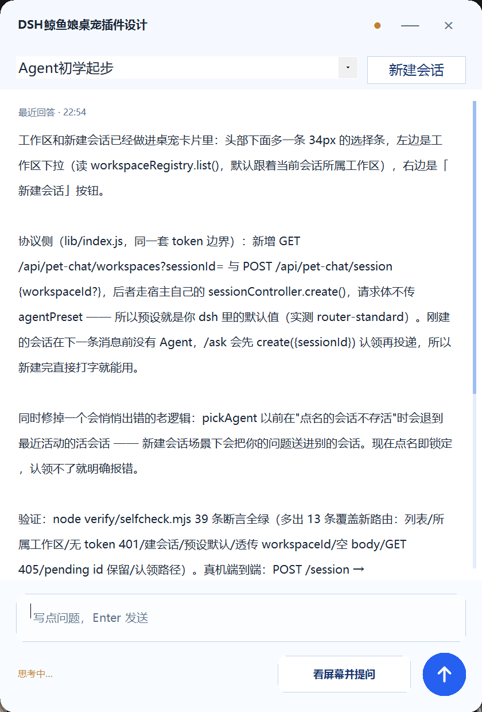

# dsh-pet-chat

> 点一下桌面上的鲸鱼娘，打字问它。它会自己看你此刻的屏幕，把「问题 + 一帧截图」送进你正在用的 dsh 会话，再把答案吐回那张小卡片。

Windows · PowerShell 5.1 · 需要 dsh 桌面端与官方桌宠 `dsh-tauri-pet` · MIT



---

## 它解决什么

学习时遇到没见过的东西，截图 → 保存 → 粘贴 → 描述，四步太烦。这个插件只留一步：**点桌宠，打字**。
屏幕内容由它自己抓，问题和那一帧一起进 dsh 的当前会话，所以后台那个正在跑的 dsh 能直接接着看、接着答。

## 它不是什么

- 不是新的宠物形象：形象与动画复用官方 `dsh-tauri-pet`，本插件只负责"看屏幕 + 聊天"这一层。
- 不是独立应用：答案来自你正开着的 dsh（同一个会话、同一份上下文）。
- 没有云端：截图只在你本机的 dsh 进程与卡片进程之间传递。

## 前置条件

| 需要 | 说明 |
| --- | --- |
| Windows 10/11 + PowerShell 5.1 | 卡片是 WinForms 脚本，用系统自带 PowerShell 跑 |
| dsh 桌面端在运行 | 提供 `/api/pet-chat/*` 四条本地路由 |
| 官方桌宠 `dsh-tauri-pet` 已启用 | 点它唤出卡片（插件不自己画宠物） |

## 安装

```powershell
# 装进 dsh 的 profile（web 是你的 profile 名），然后重启 dsh
dsh plugin --profile web add "<本目录>"
```

就这样，没有第二步：**桌面端启动时会自己把卡片进程拉起来**（`cordis.patch.yml` 里的 `autoStartCard: true`）。
卡片平时完全隐藏（只在托盘留一个图标），屏幕上你只会看到官方桌宠那只鲸鱼娘；重启电脑也不用再动它。

不想要自启：把 `cordis.patch.yml` 里 `autoStartCard` 改成 `false`，之后用 `pet-chat.cmd` 手动起。
卡片脚本自带单实例锁，重复拉起会立刻自退，所以手动和自启混着用也不会出现两张卡。

插件加载时会把 `{base, token, pid}` 写到 `%USERPROFILE%\.dsh\pet-chat\endpoint.json`，卡片靠它找到 dsh，每个请求带 `x-pet-token`。
卡片每 800ms 重读这个文件，所以 **dsh 后起也没关系**，起来后卡片会自己接上（token 换了也会自动重试一次）。

## 使用

1. **点屏幕上的鲸鱼娘** → 卡片从右侧弹出。
2. 打字，然后：
   - 按 `Enter` 或点右下角圆形箭头 = 只发问题；
   - 点 `看屏幕并提问` = 连当前屏幕一帧一起发。
3. header 下面那条：左边换工作区，右边 `新建会话`（预设走 dsh 的默认，不写死）。
4. 卡片可以拖：按住任意空白处移动，贴四边/四角 12px 内拖动改大小。位置与大小记在 `%USERPROFILE%\.dsh\pet-chat\card.json`，下次沿用。
5. `—` 收起（再点鲸鱼娘唤回）、`×` 关掉卡片进程；彻底退出用托盘右键。

## 工作原理

```
鲸鱼娘（官方 dsh-tauri-pet 窗口）
        │ 点它：外部观测窗口矩形 + GetAsyncKeyState
        ▼
pet-chat.ps1（WinForms 卡片进程）
        │ HTTP + x-pet-token
        ▼
dsh 宿主插件（lib/index.js）
   GET  /api/pet-chat/state?sessionId=   会话列表 / 最后回答 / 运行状态
   GET  /api/pet-chat/workspaces         工作区列表
   POST /api/pet-chat/session            新建会话（预设默认）
   POST /api/pet-chat/ask                问题 + 可选截图 → 当前会话
        │ ctx.get('agents').get(id).followup(...)
        ▼
你正在用的 dsh 会话（截图存进附件区，消息排队下一轮）
```

卡片不碰 dsh 内部：它只读端点文件、发 HTTP、按 800ms 轮询答案。所以 dsh 崩了它只是显示"未连接"。

## 验证

```powershell
node verify\selfcheck.mjs        # 宿主四条路由的桩测试（39 条断言）
```

卡片侧的等价物是 `card.log`：每次点击、每次发送、每份排版都会留一行。

## 排错

| 现象 | 原因 | 处理 |
| --- | --- | --- |
| 「未连接 dsh（缺 endpoint.json）」 | dsh 没起 / 插件没装 / 端点文件是上次的 | 先起 dsh；`dsh plugin --profile web list` 确认插件在；仍是旧的就连 dsh 一起重启 |
| 重启后点鲸鱼娘没反应 | 卡片进程没起来（旧版本需要手动双击 `pet-chat.cmd`） | 新版由桌面端自启，确认插件是 0.2 之后；看 `%USERPROFILE%\.dsh\pet-chat\host.log` 有没有 `spawn ok`，`card.log` 有没有 `run: 进入消息循环`；托盘右键也能「显示聊天卡」 |
| 点鲸鱼娘没反应 | 点到宠物窗的透明留白（宠物只占窗内约 62%×82%） | 点鲸鱼娘本体而不是边角 |
| 输入后没回音 | 会话还不是活体（刚新建），或 dsh 正在跑别的回合 | 新建会话的第一次提问会自动认领；回显靠 800ms 轮询 |
| 点了发送没反应 | 见 `card.log` | 有 `send:` 说明送出、看 `view:` 是否正常；两行都缺就是入口没触发 |

## 已知边界

- 仅 Windows（WinForms + GDI）。
- 触发依赖外部观测官方宠物窗口：不注入、不改壳，代价是"必须点宠物本体"。
- 预设固定走 dsh 默认值，卡片里不提供切换。
- 右侧细条是滚动进度指示，不可拖（滚轮 / PageUp / PageDown / Home / End 可滚）。

## 仓库结构

```
lib/index.js        宿主半边：四条路由 + token 边界 + 会话注入
pet-chat.ps1        卡片半边：WinForms 悬浮窗（窗口观测、抓屏、轮询、拖拽）
msgview.cs          自绘消息视图（精确行高 + 圆角气泡，RichTextBox 做不到）
cordis.patch.yml    插件注入声明
verify/selfcheck.mjs 宿主桩测试
design-demos/       三版 UI 视觉稿（Bento / Raycast 浮层 / 原研哉），当前实现取第 2 版
DESIGN.md           设计文档与逐轮决策记录（含踩过的坑）
```

## License

MIT，见 [LICENSE](LICENSE)。
